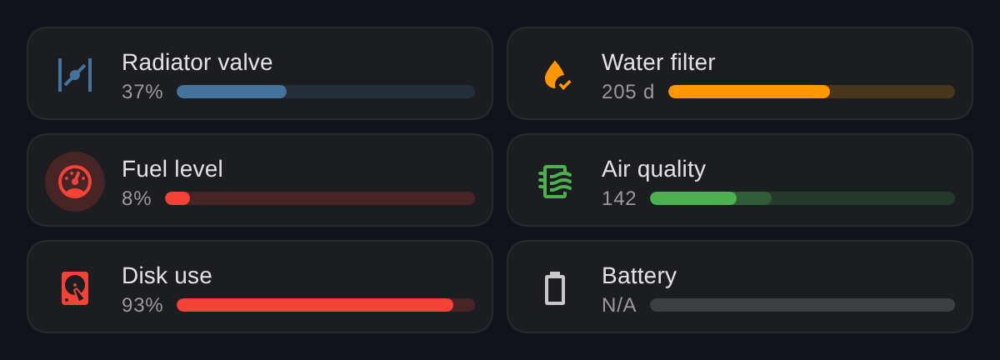
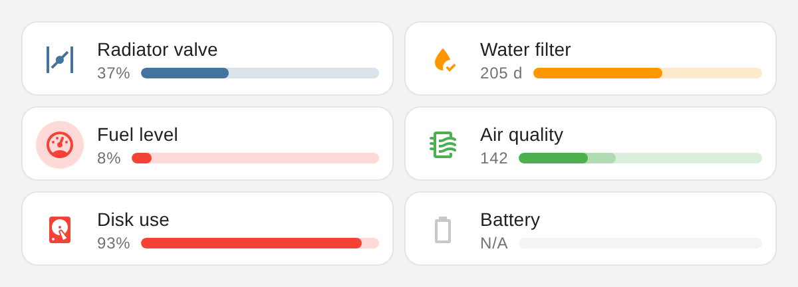

# Mushroom Bar Card

[](https://github.com/hacs/integration)
[](https://github.com/arnocl/mushroom-bar-card/releases)
[](https://github.com/arnocl/mushroom-bar-card/actions/workflows/validate.yml)

A compact progress bar card for Home Assistant, designed to sit naturally next to [Mushroom](https://github.com/piitaya/lovelace-mushroom) and native Tile cards. Show any numeric sensor or counter as a bar, and let severity thresholds colour both the icon and the bar.

> This is an independent card and is not part of, or affiliated with, the Mushroom project.





## Background

This card grew out of [Bar Card](https://github.com/custom-cards/bar-card) (`custom:bar-card`), the well-known bar card for Home Assistant. Bar Card does not offer a Mushroom-style layout. To make it fit a Mushroom dashboard, I used Bar Card with a few kilobytes of `card_mod` CSS and Jinja on every card ([shared on the community forum](https://community.home-assistant.io/t/lovelace-bar-card/87503/864)).

Mushroom Bar Card turns that styling into a standalone card. It gives the same look in a handful of YAML lines, without `card_mod` or other dependencies. It is a new implementation and does not contain Bar Card code. Many thanks to the Bar Card authors for the original idea.

## Features

- Mushroom-style layout: icon, name, value and bar in a single row (one grid row in sections views)
- Severity colours applied to icon **and** bar, with thresholds in any order (works for "low is bad" too, such as fuel or battery levels)
- Optional target zone on the bar
- Greyed-out `N/A` state for unavailable or unknown entities
- Tap, hold and double-tap actions
- Visual editor for the basic options
- Follows your theme in light and dark mode

## Installation

### HACS / Marketplace

1. Open **Settings → Marketplace** (Home Assistant 2026.11 and later) or **HACS** on older versions.
2. Search for **Mushroom Bar Card** and install it.
3. Refresh your browser.

Until the card is in the default store, add it as a custom repository first: use **Add from link** (Marketplace) or **Custom repositories** (HACS) with `https://github.com/arnocl/mushroom-bar-card` and category **Dashboard**.

### Manual

1. Download `mushroom-bar-card.js` from the [latest release](https://github.com/arnocl/mushroom-bar-card/releases).
2. Copy it to `/config/www/`.
3. Under **Settings → Dashboards → Resources**, add `/local/mushroom-bar-card.js` as a **JavaScript module**.
4. Refresh your browser.

## Configuration

```yaml
type: custom:mushroom-bar-card
entity: counter.water_filter
name: Water filter
icon: mdi:water-check
max: 365
target: 180
unit: " d"
severity:
  - { from: 0, color: green }
  - { from: 180, color: orange }
  - { from: 240, color: red }
```

| Option | Type | Default | Description |
|---|---|---|---|
| `entity` | string | **required** | A numeric sensor, counter, input_number, … |
| `name` | string | friendly name | Name shown on the card |
| `icon` | string | entity icon | Any `mdi:` icon |
| `min` | number | `0` | Start of the scale |
| `max` | number | `100` | End of the scale |
| `target` | number | – | Shows a target zone between the current value and the target |
| `unit` | string | entity unit | Text placed directly after the value, e.g. `"%"` or `" d"` |
| `decimals` | number | – | Fixed number of decimals |
| `color` | string | `blue` | Colour used when no `severity` is set |
| `severity` | list | – | Thresholds; see below |
| `icon_background` | boolean | `false` | Tinted circle behind the icon |
| `height` | number | `8` | Bar height in pixels |
| `tap_action` | action | `more-info` | Standard [Home Assistant action](https://www.home-assistant.io/dashboards/actions/) |
| `hold_action` | action | – | Standard Home Assistant action |
| `double_tap_action` | action | – | Standard Home Assistant action |

When neither `unit` nor `decimals` is set, the value is formatted by Home Assistant itself, including your locale and the entity's display precision.

### Severity

Each entry has a `from` value and a `color`. The card uses the highest `from` that the current value has reached. The order in the list does not matter.

```yaml
# Fuel level: low is bad
severity:
  - { from: 0, color: red }
  - { from: 10, color: orange }
  - { from: 20, color: green }
```

### Colours

Named colours: `green`, `orange`, `red`, `blue`, `yellow`, `purple`, `teal`, `grey`.
You can also use an RGB triplet (`76,175,80`), a hex value (`#4caf50`), `rgb(...)`, or any CSS colour. Other plain names are mapped to Home Assistant's theme colours (`amber` → `var(--amber-color)`).

## Examples

<details>
<summary>Radiator valve with a fixed colour</summary>

```yaml
type: custom:mushroom-bar-card
entity: sensor.radiator_valve_living_room
name: Radiator valve
icon: mdi:valve
unit: "%"
color: blue
```
</details>

<details>
<summary>System monitor</summary>

```yaml
type: custom:mushroom-bar-card
entity: sensor.disk_use_percent
name: Disk use
icon: mdi:harddisk
unit: "%"
severity:
  - { from: 0, color: green }
  - { from: 81, color: orange }
  - { from: 91, color: red }
```
</details>

<details>
<summary>Air quality with a target</summary>

```yaml
type: custom:mushroom-bar-card
entity: sensor.air_quality_voc_index
name: Air quality
icon: mdi:air-filter
max: 500
target: 200
severity:
  - { from: 0, color: green }
  - { from: 200, color: orange }
  - { from: 350, color: red }
```
</details>

## License

[MIT](LICENSE)
